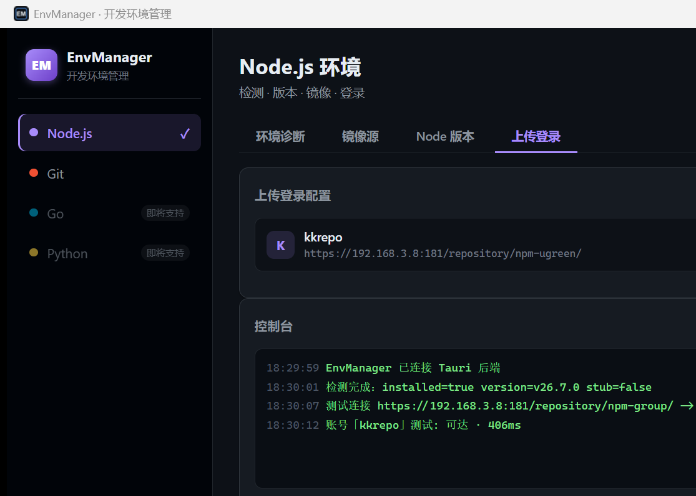

# DevEnvManager · 开发环境管理工具

一款本地桌面 GUI 工具，统一管理开发环境：**Node.js 环境体检/版本切换/镜像源/包管理器/发布账号/项目级管理/包发布**、**Python 版本管理/pip 镜像/包管理器**，以及 **Git 多账号/SSH 密钥/身份切换/仓库同步**。附赠 `devenv` CLI（无 GUI 版本）。

基于 **Rust + Tauri 2** 构建，前端使用原生 HTML/CSS/JS（无构建工具依赖）。

## 功能

### Node.js
| 模块 | 说明 |
|---|---|
| 环境诊断 | 检测 Node/npm 安装状态、版本、PATH、商店假命令、网络连通性 |
| 镜像源 | 切换 npm registry（官方 / npmmirror / 自定义），测试连接（含自签名 HTTPS） |
| Node 版本 | 安装/切换/卸载版本（每大版本取最新），nvm 检测与守卫，卸载 nvm 引导 |
| 上传登录 | 管理 npm registry 账号（token / basic），多账号切换，whoami 认证验证 |
| 包管理器 | 管理 pnpm / yarn / cnpm / pm2 / bun，安装/切换版本，显示安装位置与数据目录 |
| 项目管理 | 打开项目目录，解析 `.nvmrc` / `package.json` / 项目 `.npmrc` 要求，一键应用 Node 版本与包管理器 |
| 发布 | 扫描 `packages/` 下可发布包（支持 monorepo），按上传登录账号发布到指定 registry，发布前可选构建 |
| 证书信任 | 探测自签名 HTTPS 证书，一键信任并写入 Node extra CA，管理已信任证书 |

### Python
| 模块 | 说明 |
|---|---|
| 环境诊断 | 检测 Python/pip 安装状态、版本、PATH、商店假命令、外来安装（官方安装器 / py launcher / conda），网络连通性 |
| pip 镜像 | 切换 pip index（官方 / 清华 / 阿里云 / 自定义），测试连接（PyPI `{base}/simple/` 探测） |
| Python 版本 | 安装/切换/卸载版本（每小版本取最新）；混合源：npmmirror 完整 zip（3.11.9+）优先，老版本回退 python-build-standalone |
| 包管理器 | 管理 pip / uv / poetry / pipenv / conda |
| 项目管理 | 解析 `.python-version` / `pyproject.toml` / `runtime.txt` / `Pipfile`，一键应用 Python 版本 |

### Git
| 模块 | 说明 |
|---|---|
| 账号管理 | 读写 SSH config，管理多平台 Git 账号（GitHub/Gitee/GitLab 等） |
| SSH 密钥 | 生成/查看公钥，一键复制，直达平台密钥管理页 |
| 身份切换 | 一键切换全局或仓库级 Git 身份 |
| 仓库同步 | 按远程地址匹配账号，`git pull --ff-only` |

### CLI（无 GUI）
```bash
devenv node status                  # Node 环境体检
devenv node registry                # 查看 registry
devenv node registry set <url>      # 切换镜像源
devenv node versions                # 已装 + 可用版本
devenv node install v26.7.0         # 安装版本
devenv node switch v26.7.0          # 切换版本
devenv node uninstall v26.7.0       # 卸载版本

devenv python status                # Python 环境体检
devenv python registry              # 查看 pip index
devenv python registry set <url>    # 切换 pip 镜像
devenv python versions              # 已装 + 可用版本
devenv python install 3.12.4        # 安装版本
devenv python switch 3.12.4         # 切换版本
devenv python uninstall 3.12.4      # 卸载版本

devenv git accounts                 # 列出 Git 账号
devenv git identity                 # 当前身份
devenv git switch <alias>           # 切换身份
devenv git key <alias>              # 显示公钥
devenv git test <alias>             # SSH 连接测试
devenv git sync <repo>              # 同步仓库
```

## 技术栈

- **桌面框架**：[Tauri 2](https://tauri.app)
- **后端**：Rust（`tauri`、`serde`、`regex`、`base64`、`thiserror`、`dirs`、`chrono`、`indexmap`、`clap`）
- **前端**：原生 HTML/CSS/JS（无 React/Vite，无构建工具）
- **主题**：紫色深色（默认）/ 明亮，可切换并持久化

## 环境要求

- **Windows 10/11**（当前优先支持；Git 模块的 core 为跨平台设计）
- Rust 工具链（MSVC）+ 已安装（可用 `setup-toolchain.cmd` 一键安装）
- Git + OpenSSH（Git 模块使用，缺失时应用内提示安装引导）

## 构建与运行

```bash
# 开发运行（自动编译并启动）
start.cmd

# 或手动：
cd src-tauri
cargo build             # 编译（GUI + CLI）
cargo run               # 调试运行 GUI
cargo build --bin devenv   # 编译 CLI
cargo tauri build       # 打包安装包（需 tauri-cli）
```

> 首次编译需下载依赖，耗时较长。`start.cmd` 会自动检查工具链、增量编译并启动。

## 项目结构

```
├── src/                  # 前端（HTML/CSS/JS）
│   ├── index.html        # 主页面（Node 7 Tab + Git 4 Tab + Python 5 Tab）
│   ├── styles.css        # 样式（双主题 CSS 变量）
│   ├── main.js           # 前端逻辑
│   └── backend.js        # Tauri invoke 桥接层
├── src-tauri/            # Rust 后端
│   ├── src/lib.rs        # 命令注册 + Node/Python/镜像/账号/版本/包管理器/项目/发布命令
│   ├── src/bin/devenv.rs # CLI 入口
│   ├── src/git_cmds.rs   # Git 命令层（来自 gitAccessTool）
│   └── src/gitcore/      # Git core 逻辑（多平台）
├── start.cmd             # 一键启动脚本
├── setup-toolchain.cmd   # 工具链安装脚本（Rust + MSVC）
└── docs/screenshot.png   # 界面截图
```

## 截图



## 许可证

[Apache License 2.0](LICENSE)
